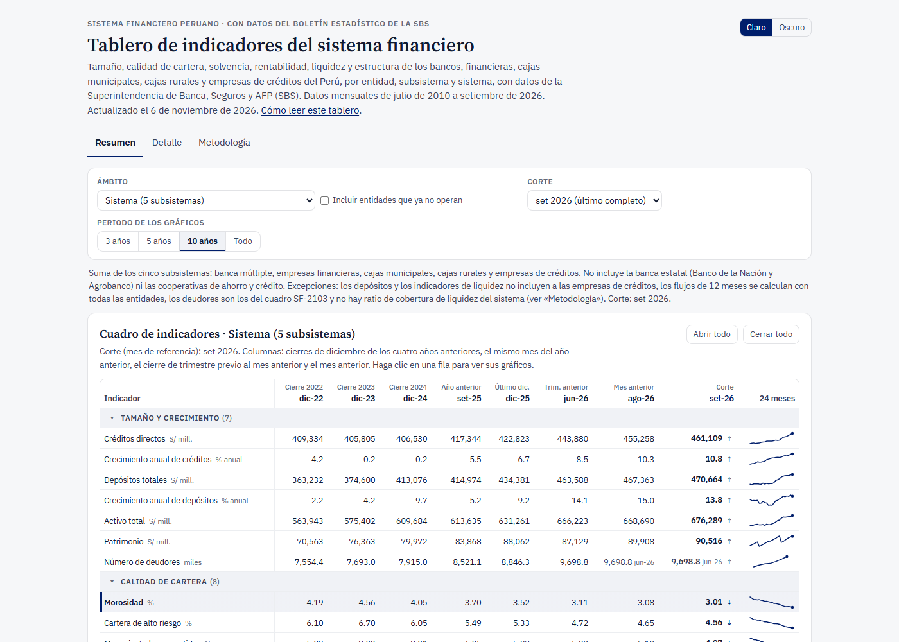

# Datos financieros del Perú

Datos públicos del **sistema financiero peruano (SBS)** y de la **macroeconomía (BCRP)**, listos para usar:
tablas limpias, el código que las descarga y procesa desde la fuente oficial, y tableros para explorarlas.

**Corte de los datos:** Boletín Estadístico de la SBS a set-2026 · tasas activas y clasificaciones a
oct-2026 · deudores SF-2103 a jun-2026 · series del BCRP descargadas el 2 de noviembre de 2026.

## Tres formas de usarlo

### 1. Ver los tableros

[](https://claude.ai/artifact/RpcG5c5WpCXR6GU5Sa3Kjv)

| Tablero | Qué muestra |
|---|---|
| [Indicadores del sistema financiero](https://claude.ai/artifact/RpcG5c5WpCXR6GU5Sa3Kjv) | Solvencia, calidad de cartera, rentabilidad, liquidez y clasificaciones de riesgo por entidad. |
| [Colocaciones y morosidad](https://claude.ai/artifact/PPHFdmX2ewtASRK5NBCKtJ) | Mora por subsistema, entidad y tipo de crédito, y qué explica el crecimiento de las colocaciones. |
| [Solvencia](https://claude.ai/artifact/Wgh9bQ9743msqWJYiJyXkh) | Ratio de capital global, patrimonio efectivo y requerimientos por riesgo. |
| [Rentabilidad](https://claude.ai/artifact/8uLaNXUKjjGpVZA6GFVDt8) | ROE, ROA, márgenes y eficiencia por subsistema y entidad. |
| [Liquidez y fondeo](https://claude.ai/artifact/UDrKKLp8y6dbsm662HL5nx) | Ratios de liquidez, cobertura de liquidez, fondeo y depósitos cubiertos por el Fondo de Seguro de Depósitos. |
| [Tasas activas](https://claude.ai/artifact/1qMDzGVELB7cUY7ynZg6xC) | Tasas de interés por tipo de crédito y entidad. |
| [Crédito por departamento](https://claude.ai/artifact/BZcFnUBFmQD8yNq4dRTJKN) | Crédito por departamento y entidad; peso de Lima y Callao y crecimiento frente al resto del país. |
| [Estados financieros](https://claude.ai/artifact/U83h9yYdcUvwwQyU2dEsBJ) | Balance y estado de resultados por subsistema y entidad. |
| [Reservas internacionales](https://claude.ai/artifact/SZvCtanbmzDDNEaAQUDrZD) | Cuánto compra y vende el BCRP, de qué están hechas las reservas, cómo se invierten y de quién son. |
| [Inflación](https://claude.ai/artifact/VJnqVL64dBJqQ5P4GuwtE3) | Inflación total y subyacente, componentes y comparación con la meta. |
| [Transmisión de la política monetaria](https://claude.ai/artifact/BibvFC8kvmrnD8qGhXPhUc) | Cómo pasa la tasa de referencia a las tasas del mercado. |

Los tableros en línea muestran la versión más reciente publicada. La versión de cada corte se puede descargar
en [Releases](../../releases) (`tableros_<corte>.zip`): son archivos HTML que se abren con doble clic, sin
conexión.

### 2. Usar los datos sin correr nada

Las tablas están en [`datos/`](datos/) y se leen directamente desde GitHub:

```python
import pandas as pd

base = "https://raw.githubusercontent.com/Alberto-Ramos-Q/datos-financieros-peru/main/datos"

panel = pd.read_csv(f"{base}/sbs/panel_entidad_mes.csv")             # 55 indicadores por entidad y mes
tasas = pd.read_csv(f"{base}/sbs/tasas_activas.csv.gz")              # tasas activas por tipo de crédito
macro = pd.read_csv(f"{base}/bcrp/bcrp_panel_mensual.csv")           # series mensuales del BCRP
```

- [`datos/README.md`](datos/README.md) describe cada tabla y [`datos/DICCIONARIO.md`](datos/DICCIONARIO.md), sus columnas.
- Las tablas de `datos/` son una foto al corte indicado arriba. Para lo más reciente, corre el código (opción 3).
- Las tablas más pesadas (el dataset maestro del boletín, con más de 10 millones de filas, y los estados
  financieros por entidad) se publican en formato parquet en [**Releases**](../../releases), un paquete por corte.

### 3. Reproducirlo todo desde la fuente oficial

Requiere **Python 3.11 o superior**.

```bash
git clone https://github.com/Alberto-Ramos-Q/datos-financieros-peru.git
cd datos-financieros-peru
pip install -r requirements.txt
python -m playwright install chromium     # una sola vez: lo usa la descarga de tasas activas
```

Después, sigue los pasos de cada fuente:
- [`descargas-sbs/`](descargas-sbs/): Boletín Estadístico de la SBS (131 cuadros entre cinco subsistemas),
  tasas activas por entidad, deudores del sistema (SF-2103) y clasificaciones de riesgo.
- [`descargas-bcrp/`](descargas-bcrp/): 901 series de BCRPData (actividad, precios, política monetaria,
  tasas, tipo de cambio y reservas, sector externo y más).

Los datos crudos no están en el repositorio: los scripts los descargan de la SBS y el BCRP. La descarga
completa de la SBS tarda varias horas, porque es secuencial y con pausas para no saturar sus servidores.

## Fuentes

- **SBS:** [Boletín Estadístico del Sistema Financiero](https://www.sbs.gob.pe/app/stats_net/stats/EstadisticaBoletinEstadistico.aspx),
  tasas activas por tipo de crédito y el reporte SF-2103.
- **BCRP:** [BCRPData](https://estadisticas.bcrp.gob.pe/estadisticas/series/).
- **Clasificaciones de riesgo:** informes públicos de las clasificadoras inscritas en la SMV.

Este repositorio no es una publicación de la SBS ni del BCRP, y ninguna de las dos instituciones lo ha revisado.
Ante cualquier diferencia, vale la cifra de la fuente oficial. Los cálculos propios están señalados como tales.

## Licencia

- **Código:** [MIT](LICENSE).
- **Datos derivados:** [CC BY 4.0](LICENSE-DATA.md). Al usarlos, cita la fuente original (SBS o BCRP) y este repositorio.

## Autor

**Elisban Alberto Ramos Quispe**, economista (UNMSM). Trabaja en riesgo de crédito y analítica de datos.
[LinkedIn](https://www.linkedin.com/in/alberto-ramos-q/)

Si encuentras un error o quieres proponer una mejora, abre un [issue](../../issues).
